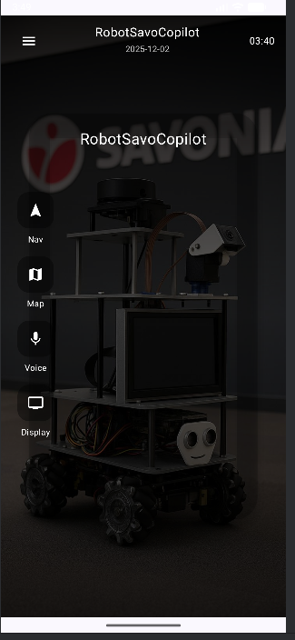
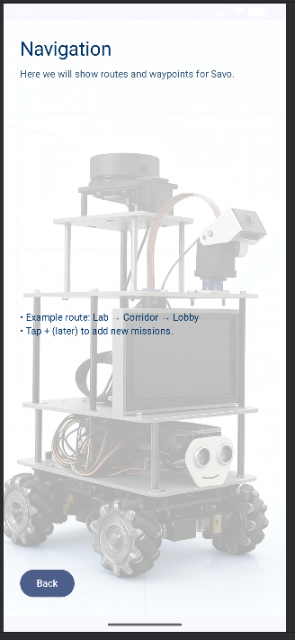
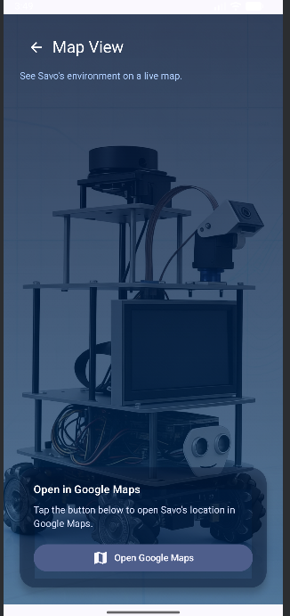
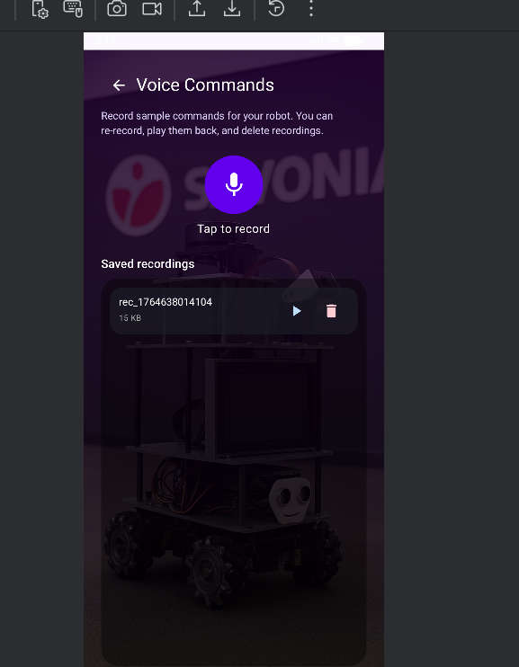
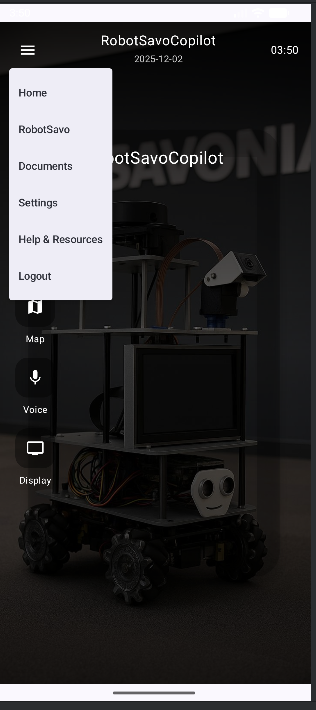

# RobotSavoCopilot

RobotSavoCopilot is an Android app built using Kotlin and Jetpack Compose.  
It acts as a control dashboard for a Savonia autonomous robot, featuring navigation, map view, voice commands, and more.  
This project demonstrates UI design, state management, navigation, data persistence, and GitHub workflow.

## Features

### Home Dashboard
- Product-style background with robot images
- Navigation to all main features
- Clean and modern UI

### Navigation Page
- Attractive futuristic background
- (Future) Robot path simulation
- Smooth back navigation

### Map Page
- Map-themed background
- Launch Google Maps with one button
- Placeholder information for future live robot tracking

### Voice Commands Page
- Record voice commands with microphone
- Save recordings locally
- Play back saved recordings
- Delete recordings
- Beautiful blurred robot background

### (Optional Extension) Missions Manager – Room Database
- Add missions for the robot
- Edit/update missions
- Delete missions
- Stored locally using Room + ViewModel + Flow

## Tech Stack

- Kotlin
- Jetpack Compose
- Material 3
- MVVM Architecture
- Compose Navigation
- MediaRecorder + MediaPlayer
- Internal Storage for audio files
- (Optional) Room Database
- Android Studio Koala+

## Screenshots

(Add your own images here)
Example:
- screenshots/home.jpg
- screenshots/navigation.jpg
- screenshots/map.jpg
- screenshots/voice.jpg

## How to Run

1. Clone the repository:
   git clone https://github.com/YOUR_USERNAME/RobotSavoCopilot.git

2. Open in Android Studio

3. Let Gradle sync

4. Run on emulator or real Android device (API 26+)

5. When asked, allow microphone permission to enable voice recording

## Project Structure

app/
 └── src/main/java/com/example/robotsavocopilot
      ├── MainActivity.kt
      ├── ui/
      │   ├── home/
      │   ├── navigation/
      │   ├── map/
      │   └── voice/
      ├── data/ (for Room database)
      └── viewmodel/

## Testing

Project includes required tests (unit/UI), such as:
- ViewModel logic test
- DAO test
- Simple UI screen test

## 📱 Screenshots

### 🏠 Home Screen

### 📍 Navigation Screen

### 🗺️ Map Screen

### 🎤 Voice Commands

### 📂 Menu Drawer

## Release

The final submission includes:
- Public GitHub repository
- README.md
- Screenshots
- Release APK / AAB (v1.0)
- PDF project report

## License

MIT License © 2025

## Note on AI Assistance

Some parts of this project were created with help from AI tools (ChatGPT),  
as allowed in the assignment instructions.

